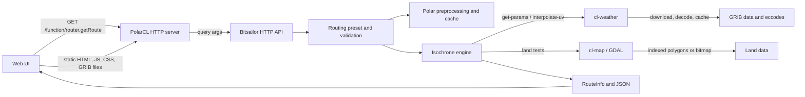

# Bitsailor Architecture

Bitsailor is a Common Lisp sailing router. The core system coordinates route search, boat polars, forecast data, land avoidance, and an HTTP/Web UI. The route search is an isochrone expansion: it propagates candidate boat positions over time, reduces each generation to a bounded set, and reconstructs a path by following predecessor links.

For the ordered-gate search, point-waypoint handling, pruning criteria and sorting replacements, see [Multi-leg routing](MULTI-LEG-ROUTING.md).

## Component Map

The ASDF system in [bitsailor.asd](bitsailor.asd) loads the application serially. It depends on `cl-geomath` for geographic types and calculations, `cl-map` for land geometry, `cl-weather` for forecast data, and PolarCL for HTTP handling. The router implementation is primarily in [simulation.cl](simulation.cl), [polars.cl](polars.cl), [filter.cl](filter.cl), and [http-api.cl](http-api.cl).

## Startup And Runtime

`start-router` in [bitsailor.cl](bitsailor.cl) loads the first available user, explicit, or source configuration file. It starts polar conversion/loading on a worker thread, initializes the database, then calls either `cl-map:ensure-map` or `cl-map:ensure-bitmap` according to `*use-bitmap*`. It starts timer/statistics work, cleans old weather cycles, starts forecast updates asynchronously, and loads the PolarCL server configuration. The process remains alive in a sentinel loop.

The router configuration supplies filesystem locations, map selection, weather settings, and the HTTP handler declarations. Weather downloads, GRIB decoding/caching, GDAL access, and HTTP connection handling are owned by the sibling libraries; Bitsailor orchestrates their APIs rather than implementing those subsystems itself.

## HTTP And Browser Boundary

PolarCL's `/function` prefix uses query-function dispatch. The current browser UI uses five registered functions: `router.getRoute`, `router.getBoatPosition`, `router.getPolarsList`, `router.getServerSettings`, and `router.getStatistics`. Query keys are passed to the Lisp function as keyword arguments. Request validation errors from `|getRoute|` are returned as HTTP 400; other errors are logged and returned as HTTP 500.

The router page is [web/router-fw.html](web/router-fw.html), driven by [web/js/router-main.js](web/js/router-main.js). Its route request sends `startTime`, start and destination latitude/longitude, `polarsId`, enabled polar `options`, `duration`, and the selected `forecast_model`, `currents`, and `useWaves` values. The response contains:

- `status`: `reached`, `no_route`, or `max_duration`.
- `best`: chronological trackpoints with position, time, heading, TWA, speed, sail, wind, and current details.
- `tracks`: optional alternative predecessor paths.
- `isochrones`: hourly frontier paths with forecast cycle and hour offset.
- `polars`, `options`, and `stats`: route metadata and summary.

The UI draws `best`, optional `tracks`, and hourly `isochrones` on the map. `stats` includes start time, duration, sail set, min/max wind and TWA, calculation time, steps, and generated point count. The browser gets datasource metadata from `router.getServerSettings`, then loads and decodes preview GRIB files directly from `/weather`; the server does not compute wind tiles for the UI.

## Browser Startup And Asset Versioning

The router initializes once at `DOMContentLoaded`, or immediately if the DOM is already ready when its module executes. It does not wait for the window's full `load` event. `setupPage` initializes the map, controls, default sail options, markers and wind canvas before requesting data. A guard prevents repeated initialization from attaching duplicate handlers or creating duplicate markers.

`loadPageData` starts the polars-list and server-settings requests together and waits for both to settle. It then populates forecast/current controls, chooses the initial forecast cycle and enables wind drawing when server settings are available. Earlier map events are ignored by `updateMap` until the wind inputs and forecast slider are ready. Polars selection restores an existing or saved selection when the returned list contains it. Settings and polars fetches request cache revalidation and have a 15-second timeout.

Failed settings, polars or initial wind loading is reported in the router header with a **Retry loading data** button. Retrying reuses the map and controls. [ServerSettings.js](web/js/ServerSettings.js) shares one settings promise among consumers; failed requests clear that promise so later attempts can retry. Successful settings are reused until an explicit reload, including the periodic forecast-update check.

### Forecast-cycle contract and route inspection

`router.getRoute` accepts an optional `cycle` query parameter as an ISO UTC source run time, for example `2026-10-31T12:00:00Z`. Run hours are validated against the selected wind source. The browser omits `cycle` on new routing requests, allowing source-specific automatic selection through `timestamp-cycle`. Its displayed run may belong to an inspected route and must not pin a new routing request. Explicit cycles remain available to API callers. The explicit cycle applies to wind, not the separately selected wave/current sources. `routing-wind-params` passes it through to `cl-weather:get-params`, whose existing `missing-forecast` handler retries the immediately previous cycle. Automatic selection and fallback can produce different actual wind cycles during one route.

The response includes `forecast-model`, `requested-cycle` (false when omitted) and `initial-cycle` (the actual initial wind cycle). Each isochrone retains the actual `cycle` from the loaded wind fields, its endpoint `time`, `wind-time` (the start-of-step sampling timestamp), and `forecast-model`. These fields survive display fragmentation. Sampling time and endpoint time are distinct: the route advances a step using wind sampled at its beginning.

Selecting an isochrone displays the recorded model/cycle at `wind-time`; the selected isochrone remains highlighted at its endpoint time. Selecting a trackpoint infers the cycle/model from the latest preceding isochrone, regardless of response ordering or stage, and requests wind at the trackpoint time. Before the first saved isochrone, it uses the response's `initial-cycle`. This is the adopted inference rule, not per-trackpoint provenance; it cannot distinguish cycle changes between saved hourly isochrones. Marker copies in adjacent map worlds carry the same timestamp.

Route inspection locks the wind source and cycle. Neither retries nor the periodic update check silently substitute a newer run. The model selector, cycle/date label, wind timestamp and slider update to match the replayed forecast. Changing the forecast model explicitly leaves route inspection mode. The header identifies recorded wind or reports that the recorded forecast is unavailable. Older responses without sufficient provenance require recomputation.

For archived runs, `router.getServerSettings?forecast_model=...&cycle=...` returns paths for that exact model and cycle. `loadForecastCycle` caches these metadata requests separately from the current preview settings. The metadata endpoint does not promise the archived files still exist: missing GRIBs remain visible errors. Cache keys use the exact source run hour rather than rounding to a six-hour boundary.

`GribCache.update` loads both bracketing fields before publishing its cycle/time to mouse lookups; failed updates preserve the previous valid state. Retries preserve the requested cycle and sampling time. Browser wind speed now interpolates scalar corner magnitudes separately from U/V, matching the weather library's interpolation policy rather than taking the magnitude of the interpolated vector.

### Versioned URLs

The startpage and router use explicit query-string revisions to prevent browsers from mixing older scripts with newer HTML. Current references include:

| Reference | Revision |
| --- | --- |
| Startpage stylesheet and main script | `?v=e97e6be` |
| Router links on the startpage | `router-fw.html?v=router-forecast-contract-20261031` |
| Router stylesheet and main script | `?v=router-forecast-contract-20261031` |
| Router import of `GribCache.js` | `?v=router-forecast-contract-20261031` |
| Both imports of `ServerSettings.js`, from the router and GRIB cache | `?v=router-forecast-contract-20261031` |

The browser caches resources by URL, including the query string. A new revision therefore requests a different resource URL and bypasses the older cached entry. PolarCL separates the query parameters from the request path, so it still serves the same underlying file. These revision strings are manually maintained identifiers, not automatically generated hashes or file-content selectors.

Versioning the router link also refreshes the HTML containing the script reference. Changing only an imported module's URL inside an already-cached parent would not help if the browser kept using the old parent module.

Matching shared-module URLs are important for state as well as freshness: ES modules are instantiated by resolved URL. `router-main.js` and `GribCache.js` import exactly the same versioned `ServerSettings.js` URL, so they share its cached settings and in-flight promise. Mixing versioned and unversioned imports would create separate module instances.

### HTTP cache policy and updates

`start-page` in [http-api.cl](http-api.cl), serving `/start`, adds `Cache-Control: no-cache`. This permits storage but requires revalidation before reuse; it does not mean `no-store`. This header helps visitors obtain the latest HTML and its versioned links. It is specific to `/start`, not a blanket cache policy on every static file. PolarCL's static-file handler separately supplies `Last-Modified` and supports conditional requests.

When publishing changes to versioned browser assets:

1. Update the affected file and its revision in the referring HTML or module.
2. Update cached parent-module references up to the page entry point, and the router link when its HTML changes, so clients actually discover the new references.
3. Keep all imports of a shared stateful module on the same revision.
4. Reload the Lisp handler if its cache policy changes. Static HTML, CSS and JavaScript are read from disk and do not require Lisp recompilation.

Unchanged modules and third-party assets are not automatically assigned the page's revision. The regression checks in [tests/router-startup-tests.cjs](tests/router-startup-tests.cjs) cover required HTML control IDs, matching versioned references, cold/late startup, both data-response orders and retry recovery. Run them from the Bitsailor directory with `node tests/router-startup-tests.cjs`.

## Weather Contract And Interpolation

For each simulation timestamp the engine obtains forecast parameters with `cl-weather:get-params` for the selected forecast model. The result contains two adjacent forecast fields (`fc0`, `fc1`) and a time fraction. The `cl-weather` implementation selects forecast steps bracketing the requested timestamp, loads or reuses the GRIB data, and falls back to a previous cycle if a requested forecast is missing.

At a route point, `cl-weather:interpolate-uv` returns four values in order: direction, speed, U component, and V component. In [cl-weather/interpolation-uv.cl](../cl-weather/interpolation-uv.cl), it:

1. Finds the surrounding grid coordinates from the GRIB increments and normalizes latitude/longitude for indexing.
2. Bilinearly interpolates U and V at the point independently in each of the two forecast fields. It also bilinearly interpolates the magnitudes in each field.
3. Linearly interpolates U, V, and magnitude between forecast times using the parameter fraction.
4. Computes direction from the time-interpolated U/V pair and returns direction, speed, U, and V.

Positions outside a field's valid area return zero values. Currents use the same vector interpolation interface. When waves are enabled, `cl-weather:interpolate-simple` samples the scalar wave-height field with spatial bilinear interpolation and temporal linear interpolation. `wave-factor` then applies a coarse multiplier: waves of at least 3 m apply a multiplier by angle between boat heading and wave direction (DIRPW, direction the waves come from, interpolated via sin/cos) (<60° into: -5/-10/-15%; 60-120° beam: -3/-9/-12%; >120° with: +5/+10/+15%) for 3-4/4-5/5+ m. Below 3 m the factor is 1.

The engine advances forecast parameters to each new simulation time. An explicit requested wind cycle is forwarded to `get-params`; otherwise the weather library selects a cycle from the datasource and timestamp. No explicit resolution is passed. The `forecast_model` symbol directly selects the wind datasource in the engine. The map preview independently loads GRIB files for the selected forecast model in the browser.

## Map And Land-Avoidance Contract

The engine and API use `cl-geomath` latitude/longitude values in degrees. `cl-map` opens the configured vector dataset through GDAL/OGR; the layer must have a spatial index. The map package exposes `point-on-land-p`, `intersects-land-p`, and `bm-is-land`.

`point-on-land-p` first consults a cached 0.1-degree tile, then checks candidate polygons with OGR when the tile may contain land. `intersects-land-p` similarly uses a tile quick check before testing the segment against intersecting polygons. The vector segment check assumes both endpoints are in the same tile. If bitmap mode is selected, route filtering calls `bm-is-land` on each candidate endpoint instead of testing the segment; bitmap resolution is determined by the loaded raster dimensions.

The HTTP route handler rejects a start point on land before invoking the engine. During each isochrone filter pass, candidates are rejected when they are on land (bitmap mode) or when the predecessor-to-candidate segment intersects land (vector mode). The active filter call currently supplies no zones or limits. Constraint classes and race-specific constraint declarations exist in [constraints.cl](constraints.cl) and [race-constraints.cl](race-constraints.cl), but the corresponding constraint checks in `filter-isochrone` are commented out; they do not presently constrain route expansion.

## Boat Polars And Speed

Polar files are loaded from JSON; the loader also converts CSV polar files to JSON. The format translator converts wind speeds and boat speeds from knots to metres per second and angles to floating-point degrees. Raw polars are indexed by ID and name.

`get-combined-polars` preprocesses each polar/options combination and caches it. It interpolates each sail's speed table onto 0.1-degree TWA and 0.1 m/s wind-speed grids, then precomputes the maximum speed and winning sail for each grid cell. Runtime speed lookup rounds TWA and wind speed to those grid indices and returns the selected speed/sail pair. The options bit mask controls which sail tables participate in the maximum; `encode-options` maps the `light`, `heavy`, and `reach` groups into that mask.

Best upwind and downwind VMG are also precomputed by wind-speed increment. For each wind speed, the polar layer tests angles from 0 through 170 degrees and retains the best positive and negative projections of boat speed onto the wind axis. The engine inserts those VMG angles into the TWA sampling buffer for every expanded point, in addition to the configured polar angle samples.

## Route Search

`get-routing-presets` in [http-api.cl](http-api.cl) constructs a `routing` record containing endpoints, a padded search box, polars, time limit, fan, options, and model flags. The HTTP endpoint defaults the maximum duration to `*max-route-hours*` (12 days); presets invoked directly default to one day. Start and destination are validated for land and equality. The search box adds roughly 10 degrees of latitude and longitude around the endpoints and handles antimeridian-crossing routes.

The route search in [simulation.cl](simulation.cl) proceeds as follows:

1. Initialize the isochrone with the start point and its forecast wind. Compute the great-circle destination bearing and constrain candidate positions to the configured fan around that bearing (`*max-angle*` defaults to 120 degrees).
2. For each point in the current frontier, sample local wind, optional current, and optional wave height. For each valid TWA sample between the upwind and downwind VMG angles, expand both positive and negative TWA directions.
3. Compute heading as wind direction plus TWA. Look up the best polar speed/sail, apply the wave factor, and advance the point by speed times the current step duration. When currents are enabled, add the boat and current velocity components and use the resulting speed/course over ground for advancement.
4. Reject positions outside the routing box or fan. Keep the best candidate in an angular bucket, preferring the point with the greatest distance from the start along its origin bearing. Each routepoint retains its predecessor, allowing final path reconstruction.
5. Filter the new frontier for land crossings, then test whether any candidate has reached or passed the destination distance within 1.5 degrees of the destination bearing. An empty frontier terminates as `no_route`; exhausting the duration terminates as `max_duration`.

The first step is shortened to align to a ten-minute boundary. Later step durations grow with forecast horizon: approximately two minutes initially, then ten, fifteen, and thirty minutes. The isochrone capacity is bounded by `*max-iso-points*` (1500 by default). At completion, the engine selects the frontier point nearest the destination and follows predecessor links to produce the route. Hourly frontiers are retained for the UI, and every generated step is retained in the `best` track.

`get-route-leg` also maintains `max-dist`, a per-leg array of radial high-water marks indexed by absolute bearing from the leg start. Unlike the next frontier, it persists across steps: a candidate must exceed both its current-step bucket winner and the historical radius. Marks are updated before land filtering and are not rolled back when a winner is blocked. This suppresses inward or repeated expansion but can discard useful detours; it is a pruning heuristic, not an earliest-arrival proof. See [MAX-DIST.md](diagnostics/MAX-DIST.md) for indexing, update order, examples and the distinction from gate-search history.

## Multi-Route (Waypoints)

Gate creation is temporarily disabled in the Web UI because post-crossing pruning can discard useful crossing histories (see [GATE-LENGTH.md](diagnostics/GATE-LENGTH.md)). Point waypoints remain available. Gate support remains in the API for development; imported GPX course overlays are display-only.

`getRoute` accepts an optional `waypoints=` list of intermediate targets (items separated by `~`; `lat,lon` is a point, `lat1,lon1,lat2,lon2` is a gate), visited in order before the destination. `get-route` dispatches to `get-route-via-waypoints` in [waypoints.cl](waypoints.cl) when `routing-waypoints` is set; otherwise it runs a single `get-route-leg` as before.

Consecutive gates and the following point waypoint (or final destination) are searched together by `get-route-through-gates` in [gate-search.cl](gate-search.cl). Each candidate carries its next-target index and a leg origin. All stages advance on a common simulation clock. The search continues approaching a gate after its first crossing: earlier crossings already travelling downstream compete with later crossings when those enter the next stage. Termination is at the destination of the group, rather than at the first gate crossing.

Each bucket retains only its outward winner: a candidate replaces the incumbent if its radius is greater or equal, otherwise it is discarded. Land checks run after selection; a blocked winner leaves an empty bucket, just as in the single-leg router. There is no candidate pool, insertion or spacing scan. Gate crossings are checked using the complete original step, including the portion before the recorded intersection. Ordered gate intersections are recorded as predecessor routepoints with fractional crossing times. For this initial implementation, the boat completes the crossing step on its existing heading and starts steering towards the next target at the following step; it does not yet turn at the fractional crossing time. Multiple gates crossed in one segment advance progress in intersection order.

Pruning uses separate origin-centred bearing buckets for each gate stage. The fixed reference is the original start for stage zero and the previous gate midpoint for later stages. At the same simulation time, each bucket retains the point farthest from that reference, independently of its actual crossing origin and time. This preserves a broad outward frontier instead of compressing the approach into a few bearings from a distant target. `*gate-bucket-width*` defaults to 0.24 degrees, each bucket has one winner, and the effective width respects the `*max-iso-points*` budget per stage. The search fan uses a separate origin: each state’s actual last crossing point (the route start in stage zero). Both the target bearing and candidate bearing for the fan test are measured from that point. Angular buckets, radial history and the coarse search box continue to use the fixed stage reference. A crossing step completes its old-stage heading before next-stage steering begins; its endpoint must also pass the resulting stage’s actual-crossing fan test to be retained. This remains a bounded heuristic rather than a guarantee of global optimality; total frontier capacity grows with the number of gate stages.

Hourly drawings use the outer envelope in the same origin-centred buckets. Angular gaps and large spatial jumps produce separate polylines, so points from disconnected sections cannot form radial spokes. All stages share the same simulation timestamp, including frontiers which have not yet crossed an earlier gate. Alternative `tracks` are currently omitted for gate groups.

Point waypoints remain serial boundaries. After a group reaches its point waypoint, the existing VMG approach hits that point exactly, trying recent predecessors, but never looking back before the last gate crossing. The arrival starts the next group with the remaining duration. Groups without gates retain the original single-leg search. Currents and waves are included in ordinary expansion but remain ignored by the point approach. If a group fails or exhausts its duration, routing returns its best surviving partial track and corresponding status.

## Current Boundaries And Caveats

- The current route filter does not apply race constraints, ice limits, or exclusion zones despite the supporting types and declarations.
- The route API accepts an explicit wind cycle; the Web UI leaves it unset for automatic selection. No resolution override is exposed.
- Boat speed is selected from the best enabled sail in the polar mask. Tack/gybe and sail-change penalties are not applied.
- Land behavior differs by mode: vector mode checks each segment, while bitmap mode checks candidate endpoints only.
- Startup initializes either the vector map or bitmap according to `*use-bitmap*`, but the HTTP endpoint's start-point validation always calls `cl-map:point-on-land-p`, which requires the vector map. Bitmap deployments should verify that this validation path has a loaded vector map.
- The exact runtime data coverage, cycle schedules, and local map/GRIB paths depend on sibling-library and deployment configuration, not on the route algorithm itself.

Gate isochrone fragments carry a `stage` field (number of gates crossed within
that gate group). Overlapping stages represent different route constraints at
the same simulation time; they are not a single geometric envelope. The UI uses
solid/dashed/dotted lines and UTC/stage tooltips to distinguish them. Clicking a
fragment highlights its stage at the selected absolute UTC time, comparing both
forecast cycle and offset. Ordinary single-leg isochrones have no stage.

Gate stages now retain radial high-water marks across simulation steps, keyed by
stage and origin-bearing bucket. Candidates must exceed the previous accepted
radius in that bucket; blocked candidates do not advance the mark. This restores
the ordinary router's outward-progress heuristic and prevents coastal frontiers
from retreating into already explored sectors. Marks are local to each request.

Valid retained crossings also mark intervals along each gate
(`*gate-coverage-bins*`, default 12). Once the configured coverage fraction
(`*gate-retirement-coverage*`, default 1/2) has been reached, the stage approaching
that gate is retired at the end of the step. The default therefore requires six
of twelve distinct intervals. Already crossed states continue, including all
crossings retained in the closing step; retired stages cannot be reseeded.
Binding the fraction to 1 restores full-coverage retirement. Coverage retirement
and radial dominance are pruning heuristics, not guarantees of global optimality
in time-varying weather.

## Status and memory reporting

The startpage Status tab polls `router.getStatistics` every minute and supports manual refresh. [status.cl](status.cl) supplies the current operational configuration, raw/combined polar and race cache counts, SBCL dynamic-heap usage/limit, and unique decoded forecast-array bytes grouped by source, cycle and resolution. Snapshots hold the forecast-cache lock while examining metadata; they never scan array elements or force garbage collection. Heap usage can include reclaimable garbage and excludes native allocations. Forecast byte counts exclude headers and metadata.

The explicit settings inventory includes routing, gate, point-approach, service and path settings. It excludes transient state, locks and credentials. Configuration values are read when requested so overrides appear immediately. Legacy top-level statistics fields remain available. The UI retains previous values and displays a stale-data message on refresh failure. Tests are in `tests/status-tests.cl` and `tests/status-ui-tests.cjs`.

### Secondary wind model

Route requests accept `secondary_forecast_model` and `forecast_switch_hours`
(`off`, `6`, `12`, or `24`; omitted means off). The UI defaults to ECMWF-IFS
as the secondary model and keeps switching off until enabled. Both choices are
saved locally and with race settings. Routing parameters are merged before URL
serialization to avoid duplicate model, currents, and wave parameters.

The switch is measured from the original departure and stored as an absolute
timestamp, retained across point and gate legs. Steps end at the switch boundary;
wind sampled at or after it uses the secondary source. An explicit primary cycle
is not forwarded to a different secondary model. Each isochrone records the model
and actual cycle used for its step, preserving wind replay provenance.
