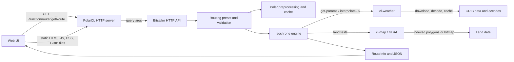

# Bitsailor Architecture

Bitsailor is a Common Lisp sailing router. The core system coordinates route search, boat polars, forecast data, land avoidance, and an HTTP/Web UI. The route search is an isochrone expansion: it propagates candidate boat positions over time, reduces each generation to a bounded set, and reconstructs a path by following predecessor links.

For the ordered-gate search, point-waypoint handling, pruning criteria and sorting replacements, see [Multi-leg routing](MULTI-LEG-ROUTING.md).

## Component Map

The ASDF system in [bitsailor.asd](bitsailor.asd) loads the application serially. It depends on `cl-geomath` for geographic types and calculations, `cl-map` for land geometry, `cl-weather` for forecast data, and PolarCL for HTTP handling. The router implementation is primarily in [simulation.cl](simulation.cl), [polars.cl](polars.cl), [filter.cl](filter.cl), and [http-api.cl](http-api.cl).

## Startup And Runtime

`start-router` in [bitsailor.cl](bitsailor.cl) loads the first available user, explicit, or source configuration file. It starts polar conversion/loading on a worker thread, initializes the database, then calls either `cl-map:ensure-map` or `cl-map:ensure-bitmap` according to `*use-bitmap*`. It starts timer/statistics work, cleans old weather cycles, starts forecast updates asynchronously, and loads the PolarCL server configuration. The process remains alive in a sentinel loop.

The router configuration supplies filesystem locations, map selection, weather settings, and the HTTP handler declarations. Weather downloads, GRIB decoding/caching, GDAL access, and HTTP connection handling are owned by the sibling libraries; Bitsailor orchestrates their APIs rather than implementing those subsystems itself.

## HTTP And Browser Boundary

PolarCL's `/function` prefix uses query-function dispatch. The current browser UI uses six registered functions: `router.getRoute`, `router.getBoatPosition`, `router.getPolarsList`, `router.getServerSettings`, `router.getCurrentField`, and `router.getStatistics`. Query keys are passed to the Lisp function as keyword arguments. Request validation errors from `|getRoute|` are returned as HTTP 400; other errors are logged and returned as HTTP 500.

The router page is [web/router-fw.html](web/router-fw.html), driven by [web/js/router-main.js](web/js/router-main.js). Its route request sends `startTime`, start and destination latitude/longitude, `polarsId`, enabled polar `options`, `duration`, and the selected `forecast_model`, `currents`, and `useWaves` values. The response contains:

- `status`: `reached`, `no_route`, or `max_duration`.
- `best`: chronological trackpoints with position, time, heading, TWA, speed, sail, wind, and current details.
- `tracks`: optional alternative predecessor paths.
- `isochrones`: hourly frontier paths with forecast cycle and hour offset.
- `polars`, `options`, and `stats`: route metadata and summary.

The UI draws `best`, optional `tracks`, and hourly `isochrones` on the map. `stats` includes start time, duration, sail set, min/max wind and TWA, calculation time, steps, and generated point count. The browser gets datasource metadata from `router.getServerSettings`, then loads and decodes preview GRIB files directly from `/weather`; the server does not compute wind tiles for the UI.

## Browser Startup And Asset Versioning

`SlidingPanels.js` manages nonmodal drawers over the full-width map. Routing
opens at the upper left by default, with Execute/progress first. Races/NMEA uses
the lower-left third, Settings the upper right, and TWA the lower-right third
below the Route Info tab. Depth clearance shares the same drawer styling at the
lower left. One drawer per side is open at a time; maps narrower than 760 px use
one overall. Edge tabs, close buttons and Escape provide manual control, and
closed contents are inert. Route statistics, fine-tuning, downloads and reverse
messages remain together in Route Info, which opens after a successful route
response. The top/bottom status bars stay outside the drawers. Map appearance
and depth controls bind to static drawer markup instead of creating Leaflet boxes.
Drawer focus changes use `preventScroll`, and the outer map frame uses
`overflow: clip` so focus during a slide animation cannot shift the whole map.
The initial start is 46°05′N 001°25′W and destination 38°21′N 26°26′W.
The map fits the destination and Göteborg (57°40′N 12°E), using fractional zoom
and desktop padding for the open Routing drawer. This framing is applied only
during map creation, so it does not reset subsequent panning or zooming.

The router initializes once at `DOMContentLoaded`, or immediately if the DOM is already ready when its module executes. It does not wait for the window's full `load` event. `setupPage` initializes the map, controls, default sail options, markers and wind canvas before requesting data. A guard prevents repeated initialization from attaching duplicate handlers or creating duplicate markers.

`loadPageData` starts the polars-list and server-settings requests together and waits for both to settle. It then populates forecast/current controls, chooses the initial forecast cycle and enables wind drawing when server settings are available. Earlier map events are ignored by `updateMap` until the wind inputs and forecast slider are ready. Polars selection restores an existing or saved selection when the returned list contains it. Settings and polars fetches request cache revalidation and have a 15-second timeout.

Failed settings, polars or initial wind loading is reported in the router header with a **Retry loading data** button. Retrying reuses the map and controls. [ServerSettings.js](web/js/ServerSettings.js) shares one settings promise among consumers; failed requests clear that promise so later attempts can retry. Successful settings are reused until an explicit reload, including the periodic forecast-update check.

### Forecast-cycle contract and route inspection

`router.getRoute` accepts an optional `cycle` query parameter as an ISO UTC source run time, for example `2026-10-31T12:00:00Z`. Run hours are validated against the selected wind source. The browser omits `cycle` on new routing requests, allowing source-specific automatic selection through `timestamp-cycle`. Its displayed run may belong to an inspected route and must not pin a new routing request. Explicit cycles remain available to API callers. The explicit cycle applies to wind, not the separately selected wave/current sources. `routing-wind-params` passes it through to `cl-weather:get-params`, whose existing `missing-forecast` handler retries the immediately previous cycle. Automatic selection and fallback can produce different actual wind cycles during one route.

The response includes `forecast-model`, `requested-cycle` (false when omitted) and `initial-cycle` (the actual initial wind cycle). Each isochrone retains the actual `cycle` from the loaded wind fields, its endpoint `time`, `wind-time` (the start-of-step sampling timestamp), and `forecast-model`. These fields survive display fragmentation. Sampling time and endpoint time are distinct: the route advances a step using wind sampled at its beginning.

Selecting a forward or reverse isochrone displays the recorded model/cycle at its `time`, matching the frontier timestamp and bottom status bar. The `wind-time` field remains integration provenance. Selecting a trackpoint infers the cycle/model from the latest preceding isochrone, regardless of response ordering or stage, and requests wind at the trackpoint time. Before the first saved isochrone, it uses the response's `initial-cycle`. This is the adopted inference rule, not per-trackpoint provenance; it cannot distinguish cycle changes between saved hourly isochrones. Marker copies in adjacent map worlds carry the same timestamp.

Route inspection locks the wind source and cycle. Neither retries nor the periodic update check silently substitute a newer run. The model selector, cycle/date label, wind timestamp and slider update to match the replayed forecast. Changing the forecast model explicitly leaves route inspection mode. The header identifies recorded wind or reports that the recorded forecast is unavailable. Older responses without sufficient provenance require recomputation.

Live `router.getServerSettings` metadata advertises the newest completely
downloaded cycle per source, checking the nominal run and up to eleven earlier
runs with the existing filesystem/download-completeness checks. Scheduled paths
alone are not proof of availability. A source without a complete run retains its
name with an empty path list. The browser does not guess a run from the clock.
The ten-minute refresh retains its displayed cycle and cache until the new wind
loads successfully; background load failures are quiet and keep the working
preview. Recorded selections and newer user wind requests take precedence over
an in-flight metadata refresh.

For archived runs, `router.getServerSettings?forecast_model=...&cycle=...` returns paths for that exact model and cycle. `loadForecastCycle` caches these metadata requests separately from the current preview settings. The metadata endpoint does not promise the archived files still exist: missing GRIBs remain visible errors. Cache keys use the exact source run hour rather than rounding to a six-hour boundary.

Wind arrows use approximately 21 px spacing, half the former number per screen area. With the Currents display checkbox enabled and a source selected, `CurrentLayer.js` draws shaft-and-head arrows at similar density, sampling Web Mercator cell centres in the browser at the displayed wind timestamp. Arrows range from small light blue to large dark blue at 3 kn or more. Source changes, map movement and time synchronization redraw the overlay. Disabling Currents or selecting NONE clears it and invalidates the current view; obsolete responses cannot repaint it. Load failures clear the layer and display an unavailable legend while wind remains usable.

`WindLayer.js` and `CurrentLayer.js` share one `GribCache.js` instance for file downloads, metadata indexing, frame selection and grid-aware U/V sampling. Wind drawing and hover state live in `WindLayer.js`; current drawing lives in `CurrentLayer.js`. The cache uses the shared server-settings metadata to select the latest fully downloaded current cycle independently of the wind model. The browser fetches static `/weather/` GRIB files, indexes message lead times and selects the two U/V pairs around the requested time. Regional files contain multiple times in one download; IFS uses separate forecast-step files. Values are bilinearly interpolated using each regular grid's origin, increments and scan directions, then linearly interpolated in time. The first/last field is held outside the available time range. Missing U or V zeroes the entire node without renormalizing the remaining interpolation weights; calm nodes remain valid zeros. There is no separate coastline mask, so interpolated arrows can extend slightly inland across coarse coastal cells. The legend records source, cycle and requested time. Historical current-cycle provenance is not stored in route responses.

The client keeps four compressed GRIB files and eight decoded U/V pairs shared by wind and currents, coalesces duplicate requests, and limits concurrent transfers to two. Metadata-only JSGrib parsing avoids unpacking all frames in regional files. Shared downloads can complete after a view is cancelled, allowing subsequent redraws to reuse them. The browser no longer calls `router.getCurrentField`; that endpoint remains for compatibility and retains its server-side coastline mask. Routing physics are unchanged. See [client current display](diagnostics/CURRENT-DISPLAY.md) for validation and limitations.

`cl-weather:ecmwf-ifs-current` downloads global surface currents (`sve`, eastward, and `svn`, northward, both m/s) by byte range from the IFS atmospheric GRIB files. Its 0.25° fields have a separate `ifs-current` local cache, using IFS cycle/step schedules: 3-hour steps through 144 h, then 6-hour steps through 360 h for 00/12Z runs; 06/18Z runs end at 144 h. Current bitmap missing values are zeroed as vector pairs before interpolation. The source participates in normal automatic downloads, server metadata and Status caching indicators. See the [ECMWF open-data parameter list](https://www.ecmwf.int/en/forecasts/datasets/open-data).

`routing-current-source` returns the explicitly selected current source independently of the wind model. Forward routing, gates, fine-tuning and reverse replay retain that source across primary/secondary wind-model switches. NONE disables currents; IFS currents can be combined with GFS wind, and Fairwinds currents with ECMWF wind. The client current cache also uses the selected source without wind-model substitution. The legacy `getCurrentField` endpoint ignores its `forecast_model` parameter.

Current-display samples are additionally checked against the router's vector coastline or configured land bitmap. A coarse GRIB cell can straddle the coast: zeroing its missing land nodes still allows bilinear interpolation to return nonzero flow at an inland position. Such land-centred arrows are suppressed after interpolation. This display mask does not shift the sampled coordinates or change routing physics.

The retired Fairwinds East Australia source is removed from downloads, metadata and Status; API requests naming it return HTTP 400. Saved race selections for unavailable sources fall back to NONE. The English Channel source still uses the working Fairwinds GRIB. Direct official IBI access is feasible via authenticated NetCDF/Zarr downloads and an ingestion/conversion step; see [IBI-CURRENTS.md](diagnostics/IBI-CURRENTS.md) for verified datasets, access requirements and integration work.

`WindLayer.update` loads both bracketing fields before publishing its cycle/time to mouse lookups; failed updates preserve the previous valid state. Retries preserve the requested cycle and sampling time. Wind speed interpolates scalar corner magnitudes separately from U/V, matching the weather library. Wind sampling omits missing nodes and renormalizes their weights, including the AROME policy of holding a valid frame when the other has no usable nodes. Current sampling retains zero-filled missing nodes without renormalization. Both use the same grid-coordinate calculation and temporal interpolation code.

### Versioned URLs

The startpage and router use explicit query-string revisions to prevent browsers from mixing older scripts with newer HTML. Current references include:

| Reference | Revision |
| --- | --- |
| Startpage stylesheet | `?v=news-reverse-20261113` |
| Startpage main script | `?v=status-grid-resolution-20261115` |
| Router links on the startpage | `router-fw.html?v=shared-grib-cache-20261118` |
| Router main script | `?v=shared-grib-cache-20261118` |
| Router stylesheet | `?v=shared-grib-cache-20261118` |
| Router import of `WindLayer.js`; layer imports of `GribCache.js` | `?v=shared-grib-cache-20261118` |
| Both imports of `ServerSettings.js`, from the router and GRIB cache | `?v=router-forecast-contract-20261031` |

The browser caches resources by URL, including the query string. A new revision therefore requests a different resource URL and bypasses the older cached entry. PolarCL separates the query parameters from the request path, so it still serves the same underlying file. These revision strings are manually maintained identifiers, not automatically generated hashes or file-content selectors.

Versioning the router link also refreshes the HTML containing the script reference. Changing only an imported module's URL inside an already-cached parent would not help if the browser kept using the old parent module.

Matching shared-module URLs are important for state as well as freshness: ES modules are instantiated by resolved URL. `router-main.js` and `GribCache.js` import exactly the same versioned `ServerSettings.js` URL; `WindLayer.js` and `CurrentLayer.js` import exactly the same versioned `GribCache.js` URL, so they share its cached settings and in-flight promise. Mixing versioned and unversioned imports would create separate module instances.

### HTTP cache policy and updates

`start-page` in [http-api.cl](http-api.cl), serving `/start`, adds `Cache-Control: no-cache`. This permits storage but requires revalidation before reuse; it does not mean `no-store`. This header helps visitors obtain the latest HTML and its versioned links. It is specific to `/start`, not a blanket cache policy on every static file. PolarCL's static-file handler separately supplies `Last-Modified` and supports conditional requests.

When publishing changes to versioned browser assets:

1. Update the affected file and its revision in the referring HTML or module.
2. Update cached parent-module references up to the page entry point, and the router link when its HTML changes, so clients actually discover the new references.
3. Keep all imports of a shared stateful module on the same revision.
4. Reload the Lisp handler if its cache policy changes. Static HTML, CSS and JavaScript are read from disk and do not require Lisp recompilation.

Unchanged modules and third-party assets are not automatically assigned the page's revision. The regression checks in [tests/router-startup-tests.cjs](tests/router-startup-tests.cjs) cover required HTML control IDs, matching versioned references, cold/late startup, both data-response orders and retry recovery. Run them from the Bitsailor directory with `node tests/router-startup-tests.cjs`.

## Weather Contract And Interpolation

For each simulation timestamp the engine obtains forecast parameters with `cl-weather:get-params` for the selected forecast model. The result contains two adjacent forecast fields (`fc0`, `fc1`) and a time fraction. The `cl-weather` implementation selects forecast steps bracketing the requested timestamp, loads or reuses the GRIB data, and falls back to a previous cycle if a requested forecast is missing.

At a route point, `cl-weather:interpolate-uv` returns four values in order: direction, speed, U component, and V component. In [cl-weather/interpolation-uv.cl](../cl-weather/interpolation-uv.cl), it:

1. Finds the surrounding nodes relative to the GRIB's actual first node, dimensions, increments and scan directions. Regional grids crossing Greenwich or the antimeridian retain finite coverage; global grids interpolate across the longitude seam. Boundary nodes repeat their edge index instead of accessing a nonexistent neighbour.
2. Bilinearly interpolates U and V at the point independently in each of the two forecast fields. It also bilinearly interpolates the magnitudes in each field.
3. Linearly interpolates U, V, and magnitude between forecast times using the parameter fraction.
4. Computes direction from the time-interpolated U/V pair and returns direction, speed, U, and V.

Positions outside a field's valid area return zero values. Currents use the same vector interpolation interface. When waves are enabled, `cl-weather:interpolate-simple` samples the scalar wave-height field with spatial bilinear interpolation and temporal linear interpolation. `wave-factor` then applies a coarse multiplier: waves of at least 3 m apply a multiplier by angle between boat heading and wave direction (DIRPW, direction the waves come from, interpolated via sin/cos) (<60° into: -5/-10/-15%; 60-120° beam: -3/-9/-12%; >120° with: +5/+10/+15%) for 3-4/4-5/5+ m. Below 3 m the factor is 1.

Wave access goes through `routing-wave-params` for forward routing, gates, fine-tuning and reverse replay. The combined file has frames from hour 6 through 240, every three hours through 120 and every six thereafter. Before hour 6 the first frame is held. Height and direction use the same cycle, with one previous-cycle fallback if unavailable. The request remembers that fallback. Samples beyond the selected cycle's horizon omit both fields without attempting GRIB access, and emit one warning per request. The horizon is checked against each sample timestamp: a fine-tuning replay or reverse pass may still use valid earlier wave forecasts after the forward search has exceeded the horizon. Fine-tuning tries earlier route sections repeatedly, which explains decreasing forecast steps in older warning logs. The previous wave source configuration incorrectly capped access at hour 48 and skipped available three-hour frames.

The engine advances forecast parameters to each new simulation time. An explicit requested wind cycle is forwarded to `get-params`; otherwise the weather library selects a cycle from the datasource and timestamp. No explicit resolution is passed. The `forecast_model` symbol directly selects the wind datasource in the engine. The map preview independently loads GRIB files for the selected forecast model in the browser.

## Map And Land-Avoidance Contract

Wind arrows retain the Beaufort palette with no outlines. Settings provides a
0–100% wind-opacity slider in 10% steps, initially 50%, and a separate Currents
checkbox. Arrow bitmaps are rendered opaque; CSS opacity and a short transition
composite the wind canvas without redraws or forecast requests on slider input.
Zero opacity retains the bitmap, forecast inspection and current display. Current
visibility depends only on its own checkbox and the selected routing current source.
Current arrows have a 10 CSS-pixel minimum
length, opaque blue strokes and white halos; size and darkness still encode speed.
`MapAppearance.js` binds the optional, browser-persisted **Muted map** switch in Settings, which
desaturates and lightens only Leaflet's base tile pane. Weather, depth and route
overlay colours are unaffected, and arrow density is unchanged.

The browser's optional `BathymetryLayer.js` adds a static Channel LAT depth-clearance
overlay below weather and route layers. Offline `tools/build-bathymetry.py` converts
EMODnet DTM 2024 E4 minimum cell depths (`-elevation_max`) and extrapolation flags
to locally served compressed native-grid chunks. Draft plus clearance sets the
red-shading threshold; missing/extrapolated cells are hatched. Coarse display
pixels retain minimum depths rather than averaging. This visualization does not
change routing or apply tides. Generated data is deployed separately from Git;
see [bathymetry setup and data contract](diagnostics/BATHYMETRY.md).

The engine and API use `cl-geomath` latitude/longitude values in degrees. `cl-map` opens the configured vector dataset through GDAL/OGR; the layer must have a spatial index. The map package exposes `point-on-land-p`, `intersects-land-p`, and `bm-is-land`.

`point-on-land-p` first consults a cached 0.1-degree tile, then checks candidate polygons with OGR when the tile may contain land. `intersects-land-p` similarly uses a tile quick check before testing the segment against intersecting polygons. The vector segment check assumes both endpoints are in the same tile. If bitmap mode is selected, route filtering calls `bm-is-land` on each candidate endpoint instead of testing the segment; bitmap resolution is determined by the loaded raster dimensions.

The HTTP route handler rejects a start point on land before invoking the engine. During each isochrone filter pass, candidates are rejected when they are on land (bitmap mode) or when the predecessor-to-candidate segment intersects land (vector mode). The active filter call currently supplies no zones or limits. Constraint classes and race-specific constraint declarations exist in [constraints.cl](constraints.cl) and [race-constraints.cl](race-constraints.cl), but the corresponding constraint checks in `filter-isochrone` are commented out; they do not presently constrain route expansion.

## Boat Polars And Speed

Polar files are loaded from JSON; the loader also converts CSV polar files to JSON. The format translator converts wind speeds and boat speeds from knots to metres per second and angles to floating-point degrees. Raw polars are indexed by ID and name.

`get-combined-polars` preprocesses each polar/options combination and caches it. It interpolates each sail's speed table onto 0.1-degree TWA and 0.1 m/s wind-speed grids, then precomputes the maximum speed and winning sail for each grid cell. Runtime speed lookup rounds TWA and wind speed to those grid indices and returns the selected speed/sail pair. The options bit mask controls which sail tables participate in the maximum; `encode-options` maps the `light`, `heavy`, and `reach` groups into that mask.

Best upwind and downwind VMG are also precomputed by wind-speed increment. For each wind speed, the polar layer tests angles from 0 through 170 degrees and retains the best positive and negative projections of boat speed onto the wind axis. The engine inserts those VMG angles into the TWA sampling buffer for every expanded point, in addition to the configured polar angle samples.

## Route Search

`get-routing-presets` in [http-api.cl](http-api.cl) constructs a `routing` record containing endpoints, a padded search box, polars, time limit, fan, options, and model flags. The HTTP endpoint defaults the maximum duration to `*max-route-hours*` (12 days); presets invoked directly default to one day. Start and destination are validated for land and equality. The search box encloses the minor great-circle arc, including interior latitude extrema, then pads each side by 20% of the arc length with a minimum of 10 angular degrees. Longitude padding is divided by the cosine of the arc’s representative latitude to give a comparable physical margin. This avoids narrow bounds for similar endpoint coordinates without forcing a square box. Wrapped longitudes handle the antimeridian; pole-reaching bounds allow all longitudes, and near-antipodal routes use world bounds. Settings → Search box is enabled by default; `search_box=false` disables geographic clipping for every leg while retaining fan, bucket and land filtering. Margin defaults are `*search-box-margin-factor*` and `*search-box-min-margin*`. Waves are unchecked by default.

The route search in [simulation.cl](simulation.cl) proceeds as follows:

1. Initialize the isochrone with the start point and its forecast wind. Compute the great-circle destination bearing and constrain candidate positions to the configured fan around that bearing (`*max-angle*` defaults to 120 degrees).
2. For each point in the current frontier, sample local wind, optional current, and optional wave height. For each valid TWA sample between the upwind and downwind VMG angles, expand both positive and negative TWA directions.
3. Compute heading as wind direction plus TWA. Look up the best polar speed/sail, apply the wave factor, and advance the point by speed times the current step duration. When currents are enabled, add the boat and current velocity components and use the resulting speed/course over ground for advancement.
4. Reject positions outside the routing box or fan. Keep the best candidate in an angular bucket, preferring the point with the greatest distance from the start along its origin bearing. Each routepoint retains its predecessor, allowing final path reconstruction.
5. Filter the new frontier for land crossings, then test whether any candidate has reached or passed the destination distance within 1.5 degrees of the destination bearing. An empty frontier terminates as `no_route`; exhausting the duration terminates as `max_duration`.

The standard stepper shortens its first step to align to a ten-minute boundary. After the initial alignment step, two-minute steps end on the last ten-minute grid point no later than two hours from the original departure. Later steps use ten, fifteen, and thirty minutes, retaining the existing later-horizon thresholds. Point-waypoint legs do not restart the two-minute phase. The isochrone capacity is bounded by `*max-iso-points*` (1500 by default). At completion, the engine selects the frontier point nearest the destination and follows predecessor links to produce the route. Hourly frontiers are retained for the UI, and every generated step is retained in the `best` track.

`stepper=standard` (the default) or `stepper=hires` selects the search schedule.
Request departures are rounded forward to a full UTC minute.
`make-routing-stepper` dispatches to `make-stepper` or `make-hires-stepper` in
both single-leg and gate routing. Hires uses 60-second steps for the first eight
hours from the original departure, then rejoins the standard timestamp
grid based on a minute-aligned clock. Off-minute internal starts take a short
alignment step, including fractional seconds where necessary. The join step and forecast-model switch steps can be shorter. The original
departure is stored in `routing-stepper-starttime` and copied through point-waypoint
legs, so their eight-hour period does not restart. Invalid API values return 400.
The **Hi-res** checkbox beside Duration persists in browser settings and saved
races; older requests and races default to Standard. This selects search
integration steps independently of the fine-tuner's one-minute replay steps.

`get-route-leg` also maintains `max-dist`, a per-leg array of radial high-water marks indexed by absolute bearing from the leg start. Unlike the next frontier, it persists across steps: a candidate must exceed both its current-step bucket winner and the historical radius. Marks are updated before land filtering and are not rolled back when a winner is blocked. This suppresses inward or repeated expansion but can discard useful detours; it is a pruning heuristic, not an earliest-arrival proof. See [MAX-DIST.md](diagnostics/MAX-DIST.md) for indexing, update order, examples and the distinction from gate-search history.

## Reverse routing

For a start-to-finish route, `reverse=true` enables the optional second pass in [reverse-routing.cl](reverse-routing.cl). `reverse_percent` defaults to 2 and accepts zero. The UI displays whole per mille, with a default of 20‰ and increments of 1‰ (0.1 percentage points), and converts the value to percent for the API. The deadline is the verified forward ETA plus this percentage of elapsed passage time. The API rejects intermediate points and gates. The reverse interval from departure to deadline is bounded by the configured maximum route hours. A partial forward search or an unsuccessful exact finish returns its forward track with a reason in `reverse-routing.status`.

The forward leg records the actual step boundaries and source cycles for wind, current and both wave fields. The finish tries direct and two-board approaches from the closest points on the two frontiers bounding the arrival step, with at most thirty minutes of one-minute approach samples per attempt. If no exact approach succeeds, the normal stepper continues the forward search. It retains the earliest land-clear mark touch within 1 cm, and constrains fine-tuning to preserve that touch. The forward frontier continues on its original clock when the deadline extends beyond the last search step. The return pass reopens the recorded forecast runs and calls the shared frontier expander with negative elapsed time. Weather is sampled once per frontier point at the earlier interval time. Each TWA reverses the full ground displacement, including current, while wave effects use the physical sailing heading. This is an explicit integration approximation in spatially varying weather. Both VMG samples and the configured TWA grid are available on both tacks. The reverse bearing fan extends 90° either side of the line from the destination to the start.

The destination is available again at every step boundary, including after a temporarily empty frontier. Each step retains the outermost predecessor in each destination bearing bucket and then removes land-blocked winners, using the same winner-only pruning policy as single-leg forward routing. This approximates arrival by the deadline and can miss an interior alternative. The reverse search retains the current frontier, compact comparison positions and cycle timestamps. It discards predecessor candidates after each step.

At a common UTC timestamp the server projects both fronts about the start, preserving radius and bearing. Adjacent occupied forward buckets bound angular sectors. Reverse line segments are clipped to those sectors before display; a gap or coastline splits the line. Reverse display sections also split when adjacent points are separated by more than four step distances and four angular bucket spacings, preventing spokes from old fronts to nearby finish seeds. The first step, ten-minute boundaries in the first hour and then hourly boundaries are sampled. A route contained in one step gets a midpoint comparison. Forward comparison lines are returned in `isochrones`; reverse lines and candidate overlaps are separate arrays inside `reverse-routing`, alongside baseline, deadline, step and candidate counts. The comparison allows a 0.1 m coordinate tolerance so an equal-time tangency remains visible. A highlight indicates a place to investigate. Only replaying an individual track through it can establish that track's ETA.

Expansion costs O(B × A) per time step for B buckets and A signed TWA samples. With a fixed TWA grid this is linear in bucket count. Weather is interpolated once per active frontier point. Land filtering tests at most one winner per bucket, with additional map-tile checks for segments spanning tiles. On the archived Class 40 fixture from 46°N, 8°W to 44°N, 9.5°W departing 4 November at 20:09 UTC, the reverse overlay took 3.25 seconds for 190 steps and 5.16 million candidates. The complete request took about 14 seconds, compared with 227 seconds for the initial inverse-solving implementation. These local measurements used GFS wind, a vector coastline and 1% slack, with waves and currents disabled. Exact finishing produced the same baseline ETA.

## TWA Fine-Tuning

Fine-tuning is off by default. With `fine_tune=true` selected in Settings, after the full route search `get-route` enables `fine-tune-route` in [fine-tune.cl](fine-tune.cl). It fits up to three explicitly typed integer TWA/compass-heading segments in short anchored windows by solving durations, re-sailing them in the forecast with polar, current and wave effects. A–B–A correction patterns can cancel a smoothed prefix’s error in following segments before rejoining the original anchor. Trial steps default to one minute; heading replay always checks at least every minute and at each command endpoint. Target order, land clearance and the original tack/gybe sequence are checked. Computed anchors may advance away from the original route start with at most 500 m lateral deviation; backward movement retains the 500 m distance bound. Manoeuvre times stay within five minutes. Requested point waypoints remain fixed. Completed routes retain their endpoint and cannot arrive later; a closed-anchor incumbent protects earlier improvements. Duration-limited routes instead maximize origin distance at the identical final timestamp, preserving their originally passed target prefix. Only a completed route’s last window can shorten its duration. Failed fits retain original controls, and failed final validation restores the original route.

Fine-tuning command changes must occur on full UTC minutes. Continuous shooting
only seeds neighboring minute-grid switch times; those schedules are re-sailed
and validated before publication. Arrival timestamps may still be fractional.
`minute-controls` and `command-time-step` report this contract. Uncorrectable raw
plans have no executable segments, and schedule export refuses off-minute changes.

A broader approximation pass also tries gradual same-tack stretches with a 1 nm
lateral corridor. Command boundaries provide fixed rejoin anchors; integer
heading/TWA commands and correction tails must preserve those anchors and times.
The conservative pass reserves trial work for this pass within the shared caps.
Finished-route ETA cannot worsen, and duration-limited routes cannot finish
farther from the destination at the same final time. Manoeuvre, land and target
checks remain enforced. The Fine-tuning tooltip reports the broader corridor.

The rolling stage then tries overlapping 30-minute to four-hour windows, with
starts at command changes and half-hour intervals spread over the route. It uses
a 5 nm lateral corridor, while explicit point marks remain hard window boundaries
and all requested touches are checked to 1 cm independently of rejoin tolerances.
Each competitive patch physically re-sails its complete suffix and is retained
only after whole-route validation. Later failures retain earlier valid patches.
The initial pass keeps its 3000-trial/10-second cap; the overall cap is now 12000
trials/30 seconds, with the remainder available to rolling windows. Exact-time
weather parameters use a bounded 4096-entry scratch cache; decoded GRIB fields
remain shared. New budgets, horizons and tolerances are listed on Status, and
rolling attempts/improvements appear in the Fine-tuning tooltip.

The response supplies the general `steering-segments` mode/value plan (`twa-segments` remains available for pure-TWA plans) and a `fine-tuning` report; accepted replay replaces `best` and retains `original-best`. Refined points carry their own wind cycle/model/sample time for map inspection. Search isochrones remain the original frontier. Settings and bounded trial budgets appear on the Status tab. See [ROUTE-FINE-TUNING.md](ROUTE-FINE-TUNING.md) for the objective, shooting algorithm, tolerances and tests.

## Multi-Route (Waypoints)

The Web UI supports point waypoints and intermediate gates through its context menu. 'Add gate' places the first endpoint at the menu position and the second at the next map click. The current artificial-origin search and its limitations are described in [GATE-LENGTH.md](diagnostics/GATE-LENGTH.md). Imported GPX course overlays remain display-only.

`getRoute` accepts an optional `waypoints=` list of intermediate targets (items separated by `~`; `lat,lon` is a point, `lat1,lon1,lat2,lon2` is a gate), visited in order before the destination. `get-route` dispatches to `get-route-via-waypoints` in [waypoints.cl](waypoints.cl) when `routing-waypoints` is set; otherwise it runs a single `get-route-leg` as before.

Consecutive gates and the following point waypoint (or final destination) are searched together by `get-route-through-gates` in [gate-search.cl](gate-search.cl). Each candidate carries its next-target index and a leg origin. All stages advance on a common simulation clock. The search continues approaching a gate after its first crossing: earlier crossings already travelling downstream compete with later crossings when those enter the next stage. Termination is at the destination of the group, rather than at the first gate crossing.

Each bucket retains only its outward winner: a candidate replaces the incumbent if its radius is greater or equal, otherwise it is discarded. Land checks run after selection; a blocked winner leaves an empty bucket, just as in the single-leg router. There is no candidate pool, insertion or spacing scan. Land checks include the approach to each recorded intersection and the actual remainder of the step. Ordered gate intersections are recorded as predecessor routepoints with fractional crossing times. If the next target is more than 90 degrees behind the incoming course, the boat turns at the fractional crossing time and sails the remaining duration on a direct or VMG-boundary heading toward that target, including current and wave effects. Otherwise it completes the original heading. Multiple ordered gate touches can occur in one step, including along a turned remainder. Land checks follow every actual segment in the predecessor chain; endpoints remain on the common clock.

Pruning uses separate origin-centred bearing buckets for each gate stage. The fixed reference is the original start for stage zero and an artificial point behind the previous gate, away from the next target, for later stages. Its distance from the midpoint is `max(1000 metres, max(2, *gate-origin-distance-factor*) × gate width)`, with the factor defaulting to two. At the same simulation time, each bucket retains the point farthest from that reference, independently of its actual crossing origin and time. This preserves a broad outward frontier instead of compressing the approach into a few bearings from a distant target. `*gate-bucket-width*` defaults to 0.24 degrees, each bucket has one winner, and the effective width respects the `*max-iso-points*` budget per stage. A monotone `atan2(scale × sin(delta), cos(delta))` bearing transform concentrates bucket resolution near the next-leg axis while keeping at most 1500 buckets per stage; `scale = max(1, 2 × origin distance / max(gate width, 1000 metres))`. The search fan uses a separate origin: each state’s actual last crossing point (the route start in stage zero). Both the target bearing and candidate bearing for the fan test are measured from that point. Angular buckets and radial history use the common artificial reference. The coarse search box follows the actual origin and target. A crossing endpoint, including a turned remainder, must pass the resulting stage’s actual-crossing fan test to be retained. This remains a bounded heuristic rather than a guarantee of global optimality; total frontier capacity grows with the number of gate stages.

Hourly drawings use the outer envelope in the same origin-centred buckets. Angular gaps and large spatial jumps produce separate polylines, so points from disconnected sections cannot form radial spokes. All stages share the same simulation timestamp, including frontiers which have not yet crossed an earlier gate. Alternative `tracks` are currently omitted for gate groups.

Point waypoints remain serial boundaries. After a group reaches its point waypoint, the existing VMG approach hits that point exactly, trying recent predecessors, but never looking back before the last gate crossing. The arrival starts the next group with the remaining duration. Groups without gates retain the original single-leg search. Currents and waves are included in ordinary expansion but remain ignored by the point approach. If a group fails or exhausts its duration, routing returns its best surviving partial track and corresponding status.

## Current Boundaries And Caveats

- The current route filter does not apply race constraints, ice limits, or exclusion zones despite the supporting types and declarations.
- The route API accepts an explicit wind cycle; the Web UI leaves it unset for automatic selection. No resolution override is exposed.
- Boat speed is selected from the best enabled sail in the polar mask. Tack/gybe and sail-change penalties are not applied.
- Land behavior differs by mode: vector mode checks each segment, while bitmap mode checks candidate endpoints only.
- Startup initializes either the vector map or bitmap according to `*use-bitmap*`, but the HTTP endpoint's start-point validation always calls `cl-map:point-on-land-p`, which requires the vector map. Bitmap deployments should verify that this validation path has a loaded vector map.
- The exact runtime data coverage, cycle schedules, and local map/GRIB paths depend on sibling-library and deployment configuration, not on the route algorithm itself.

Gate isochrone fragments carry a `stage` field (number of gates crossed within
that gate group). Overlapping stages represent different route constraints at
the same simulation time; they are not a single geometric envelope. The UI uses
solid/dashed/dotted lines and UTC/stage tooltips to distinguish them. Clicking a
fragment highlights its stage at the selected absolute UTC time, comparing both
forecast cycle and offset. Ordinary single-leg isochrones have no stage.

Gate stages now retain radial high-water marks across simulation steps, keyed by
stage and origin-bearing bucket. Candidates must exceed the previous accepted
radius in that bucket; blocked candidates do not advance the mark. This restores
the ordinary router's outward-progress heuristic and prevents coastal frontiers
from retreating into already explored sectors. Marks are local to each request.

Valid retained crossings also mark intervals along each gate
(`*gate-coverage-bins*`, default 12). Once the configured coverage fraction
(`*gate-retirement-coverage*`, default 1/2) has been reached, the stage approaching
that gate is retired at the end of the step. The default therefore requires six
of twelve distinct intervals. Already crossed states continue, including all
crossings retained in the closing step; retired stages cannot be reseeded.
Binding the fraction to 1 restores full-coverage retirement. Coverage retirement
and radial dominance are pruning heuristics, not guarantees of global optimality
in time-varying weather.

## Status and memory reporting

The startpage Status tab polls `router.getStatistics` every minute and supports manual refresh. [status.cl](status.cl) supplies the current operational configuration, raw/combined polar and race cache counts, SBCL dynamic-heap usage/limit, and unique decoded forecast-array bytes grouped by source, cycle and resolution. Snapshots hold the forecast-cache lock while examining metadata; they never scan array elements or force garbage collection. Heap usage can include reclaimable garbage and excludes native allocations. Forecast byte counts exclude headers and metadata.

Both forecast tables place Resolution immediately after Source and report actual GRIB grid increments in degrees, rather than datasource filename-resolution defaults. Cache groups use their decoded grid metadata; download rows inspect the first available file header from the displayed completed/in-progress cycle without decoding forecast arrays. Different longitude/latitude spacing is shown separately, and missing metadata is shown as unavailable. The Fairwinds current regions have separate download rows so their differing grid sizes and availability remain visible.

The explicit settings inventory includes routing, gate, point-approach, service and path settings. It excludes transient state, locks and credentials. Configuration values are read when requested so overrides appear immediately. Legacy top-level statistics fields remain available. The UI retains previous values and displays a stale-data message on refresh failure. Tests are in `tests/status-tests.cl` and `tests/status-ui-tests.cjs`.

### Secondary wind model

Route requests accept `secondary_forecast_model` and `forecast_switch_hours`
(`off`, `6`, `12`, or `24`; omitted means off). The UI defaults to ECMWF-IFS
as the secondary model and keeps switching off until enabled. Both choices are
saved locally and with race settings. Routing parameters are merged before URL
serialization to avoid duplicate model, currents, and wave parameters.

The switch is measured from the original departure and stored as an absolute
timestamp, retained across point and gate legs. Steps end at the switch boundary;
wind sampled at or after it uses the secondary source. An explicit primary cycle
is not forwarded to a different secondary model. Each isochrone records the model
and actual cycle used for its step, preserving wind replay provenance.

## Routing response failures

`Util.doGET` accepts only 2xx responses and delivers network errors, aborts, timeouts and success-callback failures to the caller's error handler once. Request options are assigned after opening the XHR. Query parameters are encoded and appended to existing queries. JSON consumers use `parseJSONResponse`, which reports the received character count on parse failure. The route error path restores Execute, the cursor and progress timer. A response is parsed and checked before replacing the displayed route.

`getRoute` finishes serialization and returns UTF-8 octets to PolarCL so Content-Length measures bytes, including uncompressed Unicode labels. In the auxiliary `cl-mbedtls` system, HTTP and HTTPS writers use bounded 16 KiB blocks, continue after partial sends and retry WANT_READ/WANT_WRITE. Previously a short send raised an error and closed the connection. Combined with the old XHR status-zero success path, an interrupted response could reach JSON.parse. The reported cold-start failure has not been reproduced with its original response body, so its precise trigger remains unconfirmed.

The route handler adds `X-Route-Bytes` with the uncompressed UTF-8 size and logs that size after serialization. The client compares this with the decoded text's UTF-8 length before parsing, independently of gzip Content-Length. Error messages include the expected and received lengths, encoding and HTTP length. For the reported 15 November GFS/waves request, the cutoff at 2,281,472 characters matches a prefix of the successful 3,778,714-byte response, ending inside an isochrone point's `lng` key at a 4 KiB boundary. An isolated cold Lisp run and isolated servers' first uncompressed and gzip responses produced valid complete JSON. The gzip test returned 388,598 compressed bytes decoding to the expected 3,778,714 UTF-8 bytes. The exact browser-side trigger remains unconfirmed.

Following another browser cutoff with gzip, route XHR uses `responseType: arraybuffer` and explicit UTF-8 decoding. Route responses carry `Cache-Control: no-store`. Compression is temporarily disabled specifically for getRoute by setting `Content-Encoding: identity`; PolarCL respects a handler's identity encoding when assigning either a string or vector response body. Other endpoints retain their normal compression. Restore route compression by removing the identity header once the browser failure is isolated. A raw gzip capture of the later failing request was complete and checksum-valid, containing all 3,717,215 decoded bytes, so the precise cause remains unconfirmed.

The cutoff also occurred with identity encoding, so gzip is excluded as the sole cause. A delayed-response test with a slow reader received the complete body. PolarCL now checks the count returned by the body writer and logs completed large-body writes separately from serialization. Socket errors include the accepted offset and expected total. Route JSON requests retry the identical URL once only when the decoded byte count fails integrity validation. A second incomplete response is reported normally. Application errors and other HTTP/transport failures do not trigger this retry. The underlying intermittent cutoff remains unconfirmed.

### Optional route fine-tuning

`fine_tune=true` opts a routing request into steering post-processing; omitted
or false disables it. The unchecked **Settings → Fine-tuning** control sends
this selection on each Execute. `routing-fine-tune` is preserved in copies for
waypoint/gate legs and reverse search. `get-route` binds the tuning enable flag
per request, so concurrent requests cannot affect each other's selection.
The server's `*fine-tune-enabled*` capability flag can still disable tuning
globally. Disabled requests return a fine-tuning report with reason `disabled`
and zero trial integrations, retaining schedule/segment metadata.

### Prepared vector land cache

CL-MAP now uses exact cached prepared polygons for coastal predicates. The
2000 MiB global accounting budget is lazy and shared across maps; its conservative
charge is 16 times WKB payload plus 4096 bytes per feature, rather than a measured
native RSS limit. A bounded 0.25° feature-ID index avoids repeated shapefile
queries. The existing 0.1° coarse presence shortcut remains, using a compact
map-owned two-bit cache. Exact indexed predicates handle oversized features,
large query boxes and unsupported prepared access. Reload/close/clear release
native handles under the shared map mutex. Antimeridian segments are split
before exact checks; the existing endpoint-tile shortcut remains an approximation.

Status displays prepared-cache estimated usage/budget and counters separately
from Lisp heap memory, and lists `cl-map:*prepared-cache-*` configuration knobs.
Rebuild the Lisp image when deploying: older compiled callers can contain the
previous inlined land predicates. CL-MAP's README documents the public cleanup
and statistics APIs and the cache-accounting limits.
