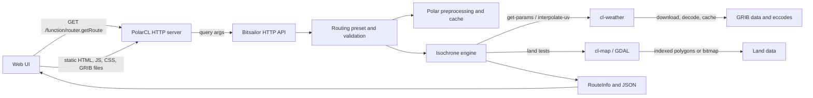

# Bitsailor Architecture

Bitsailor is a Common Lisp sailing router. The core system coordinates route search, boat polars, forecast data, land avoidance, and an HTTP/Web UI. The route search is an isochrone expansion: it propagates candidate boat positions over time, reduces each generation to a bounded set, and reconstructs a path by following predecessor links.

## Component Map

The ASDF system in [bitsailor.asd](bitsailor.asd) loads the application serially. It depends on `cl-geomath` for geographic types and calculations, `cl-map` for land geometry, `cl-weather` for forecast data, and PolarCL for HTTP handling. The router implementation is primarily in [simulation.cl](simulation.cl), [polars.cl](polars.cl), [filter.cl](filter.cl), and [http-api.cl](http-api.cl).

## Startup And Runtime

`start-router` in [bitsailor.cl](bitsailor.cl) loads the first available user, explicit, or source configuration file. It starts polar conversion/loading on a worker thread, initializes the database, then calls either `cl-map:ensure-map` or `cl-map:ensure-bitmap` according to `*use-bitmap*`. It starts timer/statistics work, cleans old weather cycles, starts forecast updates asynchronously, and loads the PolarCL server configuration. The process remains alive in a sentinel loop.

The router configuration supplies filesystem locations, map selection, weather settings, and the HTTP handler declarations. Weather downloads, GRIB decoding/caching, GDAL access, and HTTP connection handling are owned by the sibling libraries; Bitsailor orchestrates their APIs rather than implementing those subsystems itself.

## HTTP And Browser Boundary

PolarCL's `/function` prefix uses query-function dispatch. The current browser UI uses five registered functions: `router.getRoute`, `router.getBoatPosition`, `router.getPolarsList`, `router.getServerSettings`, and `router.getStatistics`. Query keys are passed to the Lisp function as keyword arguments. Request validation errors from `|getRoute|` are returned as HTTP 400; other errors are logged and returned as HTTP 500.

The router page is [web/router-fw.html](web/router-fw.html), driven by [web/js/router-main.js](web/js/router-main.js). Its route request sends `startTime`, start and destination latitude/longitude, `polarsId`, enabled polar `options`, `duration`, and the selected `forecast_model`, `currents`, and `useWaves` values. The response contains:

- `status`: `reached`, `no_route`, or `max_duration`.
- `best`: chronological trackpoints with position, time, heading, TWA, speed, sail, wind, and current details.
- `tracks`: optional alternative predecessor paths.
- `isochrones`: hourly frontier paths with forecast cycle and hour offset.
- `polars`, `options`, and `stats`: route metadata and summary.

The UI draws `best`, optional `tracks`, and hourly `isochrones` on the map. `stats` includes start time, duration, sail set, min/max wind and TWA, calculation time, steps, and generated point count. The browser gets datasource metadata from `router.getServerSettings`, then loads and decodes preview GRIB files directly from `/weather`; the server does not compute wind tiles for the UI.

## Weather Contract And Interpolation

For each simulation timestamp the engine obtains forecast parameters with `cl-weather:get-params` for the selected forecast model. The result contains two adjacent forecast fields (`fc0`, `fc1`) and a time fraction. The `cl-weather` implementation selects forecast steps bracketing the requested timestamp, loads or reuses the GRIB data, and falls back to a previous cycle if a requested forecast is missing.

At a route point, `cl-weather:interpolate-uv` returns four values in order: direction, speed, U component, and V component. In [cl-weather/interpolation-uv.cl](../cl-weather/interpolation-uv.cl), it:

1. Finds the surrounding grid coordinates from the GRIB increments and normalizes latitude/longitude for indexing.
2. Bilinearly interpolates U and V at the point independently in each of the two forecast fields. It also bilinearly interpolates the magnitudes in each field.
3. Linearly interpolates U, V, and magnitude between forecast times using the parameter fraction.
4. Computes direction from the time-interpolated U/V pair and returns direction, speed, U, and V.

Positions outside a field's valid area return zero values. Currents use the same vector interpolation interface. When waves are enabled, `cl-weather:interpolate-simple` samples the scalar wave-height field with spatial bilinear interpolation and temporal linear interpolation. `wave-factor` then applies a coarse multiplier: waves of at least 3 m apply a multiplier by angle between boat heading and wave direction (DIRPW, direction the waves come from, interpolated via sin/cos) (<60° into: -5/-10/-15%; 60-120° beam: -3/-9/-12%; >120° with: +5/+10/+15%) for 3-4/4-5/5+ m. Below 3 m the factor is 1.

The engine advances forecast parameters to each new simulation time. It does not pass a cycle or resolution argument to `get-params`; the weather library selects a cycle from the datasource and timestamp. The `forecast_model` symbol directly selects the wind datasource in the engine. The map preview independently uses NOAA GFS GRIB files in the browser.

## Map And Land-Avoidance Contract

The engine and API use `cl-geomath` latitude/longitude values in degrees. `cl-map` opens the configured vector dataset through GDAL/OGR; the layer must have a spatial index. The map package exposes `point-on-land-p`, `intersects-land-p`, and `bm-is-land`.

`point-on-land-p` first consults a cached 0.1-degree tile, then checks candidate polygons with OGR when the tile may contain land. `intersects-land-p` similarly uses a tile quick check before testing the segment against intersecting polygons. The vector segment check assumes both endpoints are in the same tile. If bitmap mode is selected, route filtering calls `bm-is-land` on each candidate endpoint instead of testing the segment; bitmap resolution is determined by the loaded raster dimensions.

The HTTP route handler rejects a start point on land before invoking the engine. During each isochrone filter pass, candidates are rejected when they are on land (bitmap mode) or when the predecessor-to-candidate segment intersects land (vector mode). The active filter call currently supplies no zones or limits. Constraint classes and race-specific constraint declarations exist in [constraints.cl](constraints.cl) and [race-constraints.cl](race-constraints.cl), but the corresponding constraint checks in `filter-isochrone` are commented out; they do not presently constrain route expansion.

## Boat Polars And Speed

Polar files are loaded from JSON; the loader also converts CSV polar files to JSON. The format translator converts wind speeds and boat speeds from knots to metres per second and angles to floating-point degrees. Raw polars are indexed by ID and name.

`get-combined-polars` preprocesses each polar/options combination and caches it. It interpolates each sail's speed table onto 0.1-degree TWA and 0.1 m/s wind-speed grids, then precomputes the maximum speed and winning sail for each grid cell. Runtime speed lookup rounds TWA and wind speed to those grid indices and returns the selected speed/sail pair. The options bit mask controls which sail tables participate in the maximum; `encode-options` maps the `light`, `heavy`, and `reach` groups into that mask.

Best upwind and downwind VMG are also precomputed by wind-speed increment. For each wind speed, the polar layer tests angles from 0 through 170 degrees and retains the best positive and negative projections of boat speed onto the wind axis. The engine inserts those VMG angles into the TWA sampling buffer for every expanded point, in addition to the configured polar angle samples.

## Route Search

`get-routing-presets` in [http-api.cl](http-api.cl) constructs a `routing` record containing endpoints, a padded search box, polars, time limit, fan, options, and model flags. The HTTP endpoint defaults the maximum duration to `*max-route-hours*` (12 days); presets invoked directly default to one day. Start and destination are validated for land and equality. The search box adds roughly 10 degrees of latitude and longitude around the endpoints and handles antimeridian-crossing routes.

The route search in [simulation.cl](simulation.cl) proceeds as follows:

1. Initialize the isochrone with the start point and its forecast wind. Compute the great-circle destination bearing and constrain candidate positions to the configured fan around that bearing (`*max-angle*` defaults to 120 degrees).
2. For each point in the current frontier, sample local wind, optional current, and optional wave height. For each valid TWA sample between the upwind and downwind VMG angles, expand both positive and negative TWA directions.
3. Compute heading as wind direction plus TWA. Look up the best polar speed/sail, apply the wave factor, and advance the point by speed times the current step duration. When currents are enabled, add the boat and current velocity components and use the resulting speed/course over ground for advancement.
4. Reject positions outside the routing box or fan. Keep the best candidate in an angular bucket, preferring the point with the greatest distance from the start along its origin bearing. Each routepoint retains its predecessor, allowing final path reconstruction.
5. Filter the new frontier for land crossings, then test whether any candidate has reached or passed the destination distance within 1.5 degrees of the destination bearing. An empty frontier terminates as `no_route`; exhausting the duration terminates as `max_duration`.

The first step is shortened to align to a ten-minute boundary. Later step durations grow with forecast horizon: approximately two minutes initially, then ten, fifteen, and thirty minutes. The isochrone capacity is bounded by `*max-iso-points*` (1500 by default). At completion, the engine selects the frontier point nearest the destination and follows predecessor links to produce the route. Hourly frontiers are retained for the UI, and every generated step is retained in the `best` track.

## Multi-Route (Waypoints)

`getRoute` accepts an optional `waypoints=lat1,lon1,lat2,lon2,...` list of intermediate targets, visited in order before the destination. `get-route` dispatches to `get-route-via-waypoints` in [waypoints.cl](waypoints.cl) when `routing-waypoints` is set; otherwise it runs a single `get-route-leg` as before.

For each intermediate target, `get-route-leg` runs isochrones until the next isochrone would pass the target (the existing `reached` test). From the frontier point closest to the target, `approach-target` sails a VMG path to the target exactly: one leg if the bearing is within the upwind/downwind VMG angles, otherwise a tack/gybe point solved from the two VMG headings (`approach-first-legs`), followed by a direct leg with exact final-step clipping. Wind is re-sampled per step (max 5 min); currents and waves are ignored on the approach. The arrival time is the start time of the next leg, and the remaining duration shrinks accordingly. If the approach crosses land (or a leg ends as `no_route`/`max_duration`), routing stops at that leg's closest isochrone point and the status is returned. Tracks, isochrones and statistics of all legs are concatenated. The UI adds waypoints via the map menu (double-click a marker to remove it).

## Current Boundaries And Caveats

- The current route filter does not apply race constraints, ice limits, or exclusion zones despite the supporting types and declarations.
- The route API has no explicit forecast-cycle or resolution override; weather selection is through the selected forecast model and simulation timestamps.
- Boat speed is selected from the best enabled sail in the polar mask. Tack/gybe and sail-change penalties are not applied.
- Land behavior differs by mode: vector mode checks each segment, while bitmap mode checks candidate endpoints only.
- Startup initializes either the vector map or bitmap according to `*use-bitmap*`, but the HTTP endpoint's start-point validation always calls `cl-map:point-on-land-p`, which requires the vector map. Bitmap deployments should verify that this validation path has a loaded vector map.
- The exact runtime data coverage, cycle schedules, and local map/GRIB paths depend on sibling-library and deployment configuration, not on the route algorithm itself.