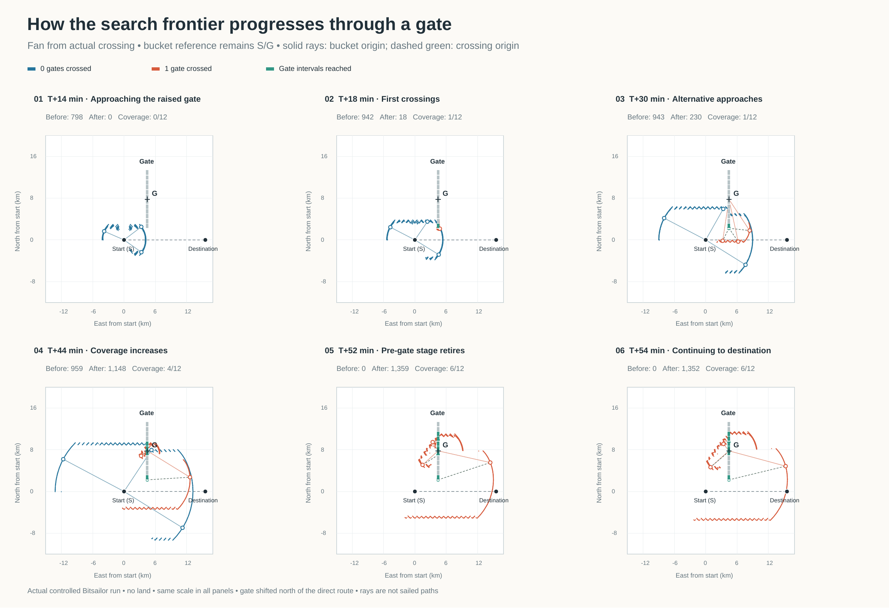

# Search-frontier progression through one gate

These figures use **retained states from a real Bitsailor gate-search run**, with a synthetic constant field and polar. They are a controlled illustration, not a forecast or a real-world route recommendation.



- [Overview, SVG](gate-frontier-overview.svg) · [Overview, PDF](gate-frontier-overview.pdf)
- [Six-page figure sequence, PDF](gate-frontier-sequence.pdf)

## Individual figures

| Time | Event | Before crossing | After crossing | Gate coverage | PNG | SVG |
| --- | --- | ---: | ---: | ---: | --- | --- |
| 14 min | Approaching the raised gate | 798 | 0 | 0/12 | [Figure 1](01-14min.png) | [Vector](01-14min.svg) |
| 18 min | First crossings; both stages active | 942 | 18 | 1/12 | [Figure 2](02-18min.png) | [Vector](02-18min.svg) |
| 30 min | Alternative approaches | 943 | 230 | 1/12 | [Figure 3](03-30min.png) | [Vector](03-30min.svg) |
| 44 min | Coverage increases | 959 | 1148 | 4/12 | [Figure 4](04-44min.png) | [Vector](04-44min.svg) |
| 52 min | Pre-gate stage retires | 0 | 1359 | 6/12 | [Figure 5](05-52min.png) | [Vector](05-52min.svg) |
| 54 min | Continuing to destination | 0 | 1352 | 6/12 | [Figure 6](06-54min.png) | [Vector](06-54min.svg) |

Blue indicates states whose histories have not crossed the gate; orange indicates histories that have crossed it. All endpoints in a panel have the same simulation timestamp. The green intervals on the gate indicate cumulative crossing coverage from valid survivors, not an active frontier. The cross labelled G marks the gate midpoint, the fixed reference for stage 1's angular buckets.

The gate is shifted north: both endpoints lie above the direct start–destination line, which is drawn in grey dashes. First retained crossings appear at 18 minutes. Gate coverage remains 1/12 through 36 minutes, increases to 4/12 at 44 minutes, and reaches the six-interval (50%) retirement threshold at 52 minutes. The pre-gate stage is then removed at the step boundary.

### Origin lines

For each active stage, three states are selected at angular quantiles of its current frontier and highlighted with hollow circles:

- **Solid blue rays** start at **S**, the fixed stage-0 reference (the route start).
- **Solid orange rays** start at **G**, the fixed stage-1 reference (the gate midpoint).
- **Dashed green-grey segments** join selected stage-1 states to their own **actual gate-crossing origins**, also marked with hollow green circles on the gate. Those origins are exported from `gate-state-origin`; they are not estimated by the renderer.

The solid rays show the reference used to measure angular buckets and outward radial progress. The dashed segments show the candidate's own crossing origin, which now also anchors its search fan. Both candidate and target bearings for the fan test are measured from that actual crossing; the annotated out-of-fan point from the earlier sequence is no longer retained. The crossing step still completes its old-stage heading, but the resulting endpoint is also checked against the new stage’s crossing-centred fan before retention. No mid-step turn is introduced. Neither is a sailed track: intermediate predecessor positions are omitted. In particular, the boat does not jump to G when it crosses the gate. The difference between these origins is especially visible because the early crossing is near the gate's lower end, well below G.

The plots show the frontier **after** applying retirement. They show every retained state as a dot, rather than connecting points across gaps or presenting only the UI's outer-envelope fragments. Dots are not sailed paths. Stage colour describes crossing history, not current side of the gate: a state that previously crossed can sail back behind the line. The later orange states west of the gate are actual search output.

Fine scallops and disconnected sections are outcomes of the discrete heading/bucket selection, not illustrative smoothing.

## Controlled setup

- Start: latitude 0°, longitude 0°.
- Gate: longitude 0.04°, from latitude +0.02° to +0.12° (approximately 2.2–13.3 km north of the direct route).
- Destination: latitude 0°, longitude 0.14°.
- Constant northerly wind, 10 m/s; artificial polar speed 5 m/s at every allowed angle.
- TWA samples: 45° through 135° in 5° increments, both tacks; VMG limits 45° and 135°.
- No waves, currents, land or geographic obstacles.
- Normal expansion, gate intersections, shared-clock stages, radial pruning, one-winner buckets and gate retirement.
- Twelve gate intervals, retirement at 50%; normal 1500-point stage budget and 0.24° minimum angular bucket width.
- The route reaches the destination criterion at 56 minutes. The sequence stops earlier to focus on gate progression.
- Equal scales and local equatorial kilometre coordinates in every panel. Projection uses 111.195 km per degree for display; the router itself performs its normal geographic computations.

## Reproduce

From the Bitsailor directory, run the capture in an isolated Lisp process; it temporarily replaces weather loading and the land predicate, restoring their definitions afterwards:

```bash
sbcl --noinform --non-interactive \
  --load /home/michael/quicklisp/setup.lisp \
  --load figures/gate-frontier/capture.cl
python figures/gate-frontier/render.py
```

The renderer needs ReportLab and `pdftoppm`. It embeds Liberation Sans in the PDFs when installed, with ReportLab's Vera font as fallback. `frontiers.json` contains all captured post-retirement snapshots, in the form `[elapsed_seconds, coverage_bits, [[stage, longitude, latitude, origin_longitude, origin_latitude], ...]]`. The Lisp capture requires no map or forecast downloads. It uses the function-replacement helper from `tests/gate-search-tests.cl`.
